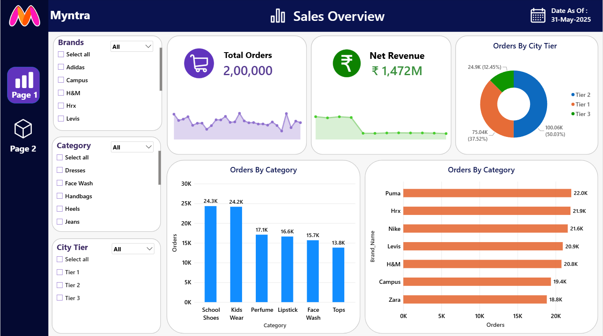
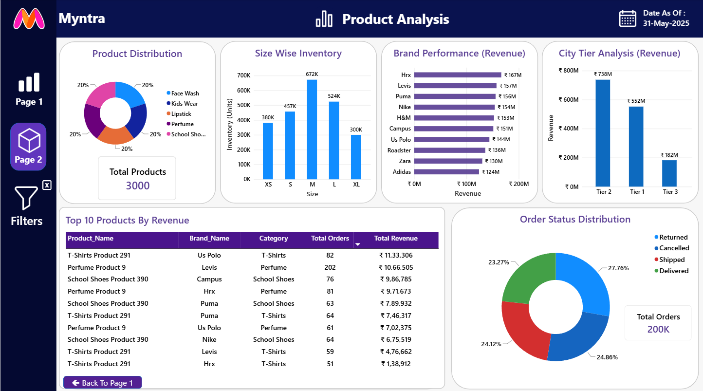

<div align="center">

# 🛍️ Myntra E-Commerce Analytics Dashboard
### *Interactive Power BI Report — Sales Overview & Product Analysis*

[](https://powerbi.microsoft.com/)
[](https://powerbi.microsoft.com/)
[](https://www.microsoft.com/en-us/microsoft-365/excel)
[](https://powerbi.microsoft.com/)

<br/>

> *"Data isn't just numbers on a grid — visualize it well, and it becomes a strategy that drives decisions."*

</div>

---

## 📋 Table of Contents

- [📌 Overview](#-overview)
- [🎯 Problem Statement](#-problem-statement)
- [✨ Key Features](#-key-features)
- [🏗️ Project Structure](#️-project-structure)
- [🔄 Project Workflow](#-project-workflow)
- [🔺 Page 1 — Sales Overview](#-page-1--sales-overview)
- [🔺 Page 2 — Product Analysis](#-page-2--product-analysis)
- [🛠️ Tech Stack](#️-tech-stack)
- [📈 Results & Insights](#-results--insights)
- [🏆 Advantages](#-advantages)
- [📄 License](#-license)
- [👤 Author](#-author)
- [🙏 Acknowledgements](#-acknowledgements)

---

## 📌 Overview

The **Myntra E-Commerce Analytics Dashboard** is a two-page interactive Power BI report that gives business teams a consolidated view of **order volume**, **net revenue**, **brand and category performance**, **city-tier contribution**, **inventory** and **order fulfilment status**.

Page 1 (**Sales Overview**) carries dropdown slicers for **Brands**, **Category** and **City Tier**, along with KPI cards and sparkline trends. Page 2 (**Product Analysis**) goes deeper into the product catalogue, size-wise inventory, brand and city-tier revenue, top-selling products and order status. Both pages share a consistent navy-and-purple theme with a left-hand navigation panel and carry the data-as-of stamp **31-May-2025**.

This project is designed to:
- Track total orders and net revenue at a glance, with trend sparklines
- Compare order volume and revenue across **city tiers**, **categories** and **brands**
- Monitor **size-wise inventory** and product distribution across categories
- Identify the **top 10 products by revenue** along with their brand, category and order count
- Understand order fulfilment health through the **order status distribution** (Delivered, Shipped, Returned, Cancelled)

---

## 🎯 Problem Statement

> **Objective:** Build an interactive Power BI dashboard that helps an e-commerce fashion and beauty business monitor sales performance, understand which brands, categories and city tiers drive revenue, and keep an eye on inventory and order fulfilment health.

A large online fashion retailer needs to answer questions such as: *How many orders are we receiving and how much revenue do they generate? Which brands and categories lead? Which city tiers contribute most? Which products earn the most? How many orders are being returned or cancelled?*

| 📂 Page | 📄 Focus | 🔍 Core Question Answered |
|--------|---------|---------------------------|
| Sales Overview | Orders & revenue | How are orders and net revenue performing across brands, categories and city tiers? |
| Product Analysis | Products, inventory & fulfilment | Which products, brands and sizes matter most, and how healthy is order fulfilment? |

---

## ✨ Key Features

| Feature | Description |
|--------|-------------|
| 🎛️ **Dropdown Slicers** | Brands, Category and City Tier slicers with *Select all* option on the Sales Overview page |
| 🏷️ **KPI Cards** | Total Orders, Net Revenue and Total Products / Total Orders cards with clear, bold values |
| 📉 **Sparkline Trends** | Area-sparkline trends under the Total Orders and Net Revenue KPIs |
| 🍩 **Composition Charts** | Donut charts for city-tier order share, product distribution and order status |
| 📊 **Comparison Charts** | Column and horizontal bar charts for categories, brands, sizes and city-tier revenue |
| 🧮 **Top 10 Table** | Ranked table of products by revenue with Brand, Category, Total Orders and Total Revenue |
| 🧭 **Left Navigation** | Page buttons, a Filters pane toggle and a **Back to Page 1** button for quick movement |
| 📅 **Data-as-of Stamp** | Date indicator (31-May-2025) displayed in the header of every page |

---

## 🏗️ Project Structure

```
📦 Myntra-PowerBI-Dashboard/
│
├── 📊 Myntra_Dashboard.pbix           ← Power BI report file (2 pages)
├── 🗂️ Data/                           ← Source data files (orders, products, brands, inventory)
│
├── 📁 Assets/                         ← Screenshot assets for documentation
│   ├── 🖼️ Sales_Overview.png          ← Page 1 screenshot
│   └── 🖼️ Product_Analysis.png        ← Page 2 screenshot
│
└── 📄 README.md                       ← Project documentation
```

> **How to open:**
> ```
> 1. Install Power BI Desktop (free): https://powerbi.microsoft.com/desktop
> 2. Open Myntra_Dashboard.pbix in Power BI Desktop
> 3. If prompted, re-point the data source to the files in the Data/ folder
> 4. Use the slicers on Page 1 and the left navigation to explore both pages
> ```

---

## 🔄 Project Workflow

```
Source Data  (Orders · Products · Brands · Inventory · Cities)
       │
       ▼  Import & clean in Power BI (Power Query)
  Data Model  (Date / Brand / Category / Product / City Tier dimensions)
       │
       ├──▶  DAX Measures Created
       │     Total Orders · Net Revenue · Total Products · Inventory Units
       │     Orders by City Tier / Category / Brand · Order Status %
       │
       ├──▶  Page 1: Sales Overview
       │     ├── 3 slicers (Brands, Category, City Tier)
       │     ├── 2 KPI cards with sparklines (Total Orders / Net Revenue)
       │     ├── Orders by City Tier donut
       │     └── Orders by Category column chart · Orders by Brand bar chart
       │
       └──▶  Page 2: Product Analysis
             ├── Product Distribution donut + Total Products card
             ├── Size Wise Inventory · Brand Performance (Revenue) · City Tier Analysis (Revenue)
             └── Top 10 Products by Revenue table · Order Status Distribution donut
```

---

## 🔺 Page 1 — Sales Overview

### 📝 1. Page Architecture

The Sales Overview page is the landing page of the report. Three dropdown slicers (**Brands, Category, City Tier**) sit on the left, followed by two KPI cards with trend sparklines, a city-tier donut chart, and two bar-style charts that break down orders by category and by brand.



---

### 🗺️ 2. KPI Cards

| KPI Card | Value |
|----------|-------|
| 🛒 **Total Orders** | **2,00,000** |
| ₹ **Net Revenue** | **₹ 1,472M** |

---

### 📊 3. Visuals

| Visual | Description |
|--------|-------------|
| **Total Orders (Sparkline)** | Area sparkline showing the order volume trend over time |
| **Net Revenue (Sparkline)** | Area sparkline showing net revenue trend, with a visible step-down partway through the period |
| **Orders By City Tier** | Donut chart — Tier 2: 100.06K (50.03%), Tier 1: 75.04K (37.52%), Tier 3: 24.9K (12.45%) |
| **Orders By Category** | Column chart — School Shoes 24.3K, Kids Wear 24.2K, Perfume 17.1K, Lipstick 16.6K, Face Wash 15.7K, Tops 13.8K |
| **Orders By Brand** | Horizontal bars — Puma 22.0K, Hrx 21.9K, Nike 21.6K, Levis 20.9K, H&M 20.8K, Campus 19.4K, Zara 18.8K |

---

### 💡 4. Key Insights

- The business processed **2,00,000 orders** generating **₹ 1,472M** net revenue
- **Tier 2 cities** contribute exactly half (**50.03%**) of all orders, followed by Tier 1 (37.52%)
- **School Shoes** and **Kids Wear** are the most ordered categories (24.3K and 24.2K)
- **Puma** leads brand-level order volume at **22.0K**, with Hrx and Nike close behind
- Brand order volumes are tightly clustered (18.8K – 22.0K), showing a balanced brand mix

---

## 🔺 Page 2 — Product Analysis

### 📝 5. Page Architecture

The Product Analysis page digs into the product catalogue and fulfilment. The top row carries four visuals (product distribution, size-wise inventory, brand revenue and city-tier revenue), while the bottom row has a **Top 10 Products by Revenue** table and an **Order Status Distribution** donut.



---

### 🗺️ 6. KPI Cards

| KPI Card | Value |
|----------|-------|
| 📦 **Total Products** | **3,000** |
| 🧾 **Total Orders** | **200K** |

---

### 📊 7. Visuals

| Visual | Description |
|--------|-------------|
| **Product Distribution** | Donut chart — Face Wash, Kids Wear, Lipstick, Perfume and School Shoes each hold **20%** of the catalogue |
| **Size Wise Inventory** | Column chart (units) — XS 380K, S 457K, **M 672K**, L 524K, XL 300K |
| **Brand Performance (Revenue)** | Horizontal bars — Hrx ₹167M, Levis ₹157M, Puma ₹156M, Nike ₹154M, H&M ₹153M, Campus ₹151M, Us Polo ₹144M, Roadster ₹136M, Zara ₹130M, Adidas ₹124M |
| **City Tier Analysis (Revenue)** | Column chart — Tier 2 ₹738M, Tier 1 ₹552M, Tier 3 ₹182M |
| **Top 10 Products By Revenue** | Table with Product Name, Brand, Category, Total Orders and Total Revenue, sorted by revenue (descending) |
| **Order Status Distribution** | Donut chart (200K centre) — Returned 27.76%, Cancelled 24.86%, Shipped 24.12%, Delivered 23.27% |

**Top 10 Products by Revenue (as shown on the dashboard):**

| # | Product | Brand | Category | Total Orders | Total Revenue |
|---|---------|-------|----------|--------------|---------------|
| 1 | T-Shirts Product 291 | Us Polo | T-Shirts | 82 | ₹ 11,33,306 |
| 2 | Perfume Product 9 | Levis | Perfume | 202 | ₹ 10,66,505 |
| 3 | School Shoes Product 390 | Campus | School Shoes | 76 | ₹ 9,86,785 |
| 4 | Perfume Product 9 | Hrx | Perfume | 81 | ₹ 9,71,673 |
| 5 | School Shoes Product 390 | Puma | School Shoes | 63 | ₹ 7,89,932 |
| 6 | T-Shirts Product 291 | Puma | T-Shirts | 64 | ₹ 7,46,317 |
| 7 | Perfume Product 9 | Us Polo | Perfume | 61 | ₹ 7,02,375 |
| 8 | School Shoes Product 390 | Nike | School Shoes | 64 | ₹ 6,75,519 |
| 9 | T-Shirts Product 291 | Levis | T-Shirts | 59 | ₹ 4,76,662 |
| 10 | T-Shirts Product 291 | Hrx | T-Shirts | 51 | ₹ 1,38,912 |

---

### 💡 8. Key Insights

- **Hrx** is the top revenue brand at **₹167M**, followed by Levis (₹157M) and Puma (₹156M)
- **Tier 2 cities** generate the highest revenue (**₹738M**, about 50% of the total), mirroring their share of orders
- **Size M** holds the largest inventory (**672K units**), while **XL** holds the least (300K)
- **T-Shirts Product 291** (Us Polo) is the single highest revenue line at **₹11,33,306**
- **Perfume Product 9** under Levis records the highest order count (**202**) in the top 10
- Only **23.27%** of orders are *Delivered*, while **Returned** (27.76%) and **Cancelled** (24.86%) together account for over half — a key area for operational improvement

---

## 🛠️ Tech Stack

| Tool | Version | Purpose |
|------|---------|---------|
| 🟡 **Power BI Desktop** | Latest | Report authoring, data modelling, DAX and publishing |
| 📐 **DAX** | Built-in | Measures for orders, net revenue, inventory and status share |
| 🧰 **Power Query** | Built-in | Data cleaning and transformation |
| 🎛️ **Slicers & Bookmarks** | Built-in | Dropdown filters, page navigation and Back button |
| 🗂️ **Excel / CSV** | Source | Raw order, product, brand and inventory data |
| 🎨 **Report Theme** | Custom | Myntra-inspired navy-and-purple theme with left navigation panel |

---

## 📈 Results & Insights

| Insight | Value |
|---------|-------|
| 🛒 Total Orders | **2,00,000** |
| ₹ Net Revenue | **₹ 1,472M** |
| 📦 Total Products | **3,000** |
| 🏆 Top City Tier | **Tier 2** — 50.03% of orders, ₹738M revenue |
| 🏆 Top Category by Orders | **School Shoes** — 24.3K orders |
| 🏆 Top Brand by Orders | **Puma** — 22.0K orders |
| 🏆 Top Brand by Revenue | **Hrx** — ₹167M |
| 🥇 Top Product by Revenue | **T-Shirts Product 291 (Us Polo)** — ₹11,33,306 |
| 👕 Highest Inventory Size | **M** — 672K units |
| ⚠️ Returned + Cancelled Orders | **52.62%** of all orders |
| 📅 Data As Of | **31-May-2025** |

---

## 🏆 Advantages

| Advantage | Detail |
|-----------|--------|
| 💼 **Executive Ready** | Clean, branded, single-screen pages suitable for management reviews |
| ⚡ **Real-Time Filtering** | KPIs, charts and sparklines respond instantly to slicer changes |
| 🔀 **Two-Lens View** | Sales performance and product analysis in one report |
| 🏙️ **City-Tier Insight** | Reveals where orders and revenue are concentrated |
| 🧾 **Product-Level Detail** | Top 10 revenue table highlights best-performing products and brands |
| 🚚 **Fulfilment Visibility** | Order status donut flags returns and cancellations at a glance |
| 🖥️ **No Code Required** | Built entirely in Power BI Desktop and shareable as a `.pbix` file |

---

## 📄 License

This project is licensed under the **MIT License** — see the [LICENSE](LICENSE) file for full details.

```
MIT License — Free to use, modify, and distribute with attribution.
```

---

## 👤 Author

<div align="center">

### Neev Shankar

> *"Data transformed into structure becomes insight; insight transformed into strategy becomes growth."*

**🎓 Role:** Data Analyst | Power BI & Excel Specialist \
**📍 Location:** India \
**🛠️ Skills:** Power BI · DAX · Microsoft Excel · Data Visualisation · Dashboard Design · Data Modelling

</div>

---

## 🙏 Acknowledgements

- 📚 [Power BI Documentation](https://docs.microsoft.com/en-us/power-bi/) — Official Power BI Desktop and DAX reference
- 🟡 [Microsoft Power BI Community](https://community.powerbi.com/) — Dashboard design tips and DAX guidance
- 🎓 [SQLBI — DAX Guide](https://dax.guide/) — DAX function and measure reference
- 💬 [Stack Overflow Community](https://stackoverflow.com/) — Problem-solving support

---

<div align="center">

---

*Made with ❤️ and ☕ — Last updated: 4 November, 2026*

</div>
